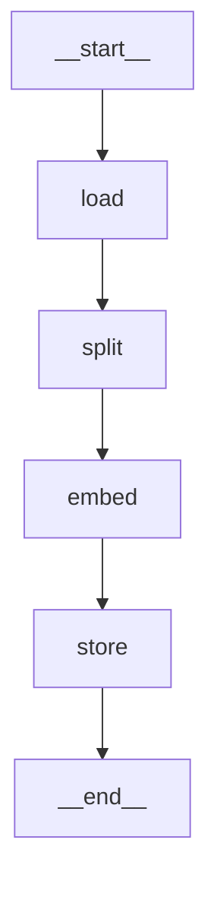

# PDF Vectorisation Pipeline (LangChain + LangGraph)

**Live deployment:** `<PASTE YOUR DEPLOYMENT URL HERE>`  (e.g. `https://yourname-nestack.onrender.com/docs`)

Two components:
1. `ingest.py` – LangGraph pipeline: **load → split → embed → store** (FAISS, persisted to `faiss_index/`).
2. `server.py` – FastAPI `POST /query` that embeds the query with the *same* model and calls
   `similarity_search_with_score()` directly. **No LLM, no RetrievalQA / conversational chain.**

## Setup
```bash
python -m venv .venv && source .venv/bin/activate
pip install -r requirements.txt

python ingest.py --file document.pdf            # builds ./faiss_index
uvicorn server:app --port 8000                  # starts API

curl -X POST localhost:8000/query -H 'content-type: application/json' \
     -d '{"query": "your question", "top_k": 3}'

python make_results.py --queries "q1" "q2" "q3" --top-k 3   # writes results.json
```
Interactive docs: `http://localhost:8000/docs`. Health check: `GET /health`.
First run downloads the ~90 MB embedding model (no API key needed).

## API
`POST /query` — body `{ "query": string, "top_k": int }` (top_k 1–50, default 4)
→ `[ { "chunk_text": str, "page_number": int (1-based), "score": float } ]`

`score` is **cosine similarity (higher = more similar)**.

## Ingestion graph
```
Graph nodes: load -> split -> embed -> store
```

Print it yourself: `python ingest.py --file x --show-graph`.

| Node | Responsibility |
|------|----------------|
| load  | `PyPDFLoader` → one `Document` per page |
| split | `RecursiveCharacterTextSplitter(1000, 200)` |
| embed | `HuggingFaceEmbeddings.embed_documents` |
| store | `FAISS.from_embeddings(...)` + `save_local()` |

## Component choices & justification
- **Loader – `PyPDFLoader`:** pure-Python, no system dependencies (unlike `UnstructuredPDFLoader`), and yields one
  Document per page with `metadata["page"]`, which is exactly what the `page_number` response field needs.
- **Splitter – `RecursiveCharacterTextSplitter`, chunk_size=1000 chars, overlap=200:**
  - 1000 chars ≈ 200–250 tokens: big enough to hold a full paragraph/idea, small enough that a chunk stays
    topically focused (large chunks dilute the embedding) and fits inside MiniLM's 256-token window without truncation.
  - 200 chars (20%) overlap keeps sentences that straddle a boundary retrievable from either side without
    ballooning index size.
  - The recursive splitter tries `\n\n` → `\n` → space → char, so it breaks on paragraph/sentence boundaries first.
  - Both are CLI-tunable: `--chunk-size`, `--chunk-overlap`.
- **Embeddings – `HuggingFaceEmbeddings` (`all-MiniLM-L6-v2`, 384-dim, normalised):** free, runs locally on CPU,
  no API key/credential needed for evaluators, strong quality for its size. Set `EMBEDDING_PROVIDER=openai`
  (+ `OPENAI_API_KEY`, `pip install langchain-openai`) to switch to `text-embedding-3-small`.
  The model used at ingestion is stored in `faiss_index/embedding_meta.json` and the server reads it, so
  **queries are always embedded with the ingestion model**.
- **Vector store – FAISS:** lightweight, file-based, zero infrastructure; persisted with the built-in
  `save_local()` and restored with `load_local()`. Exact (flat) search is ideal at this scale. With unit-length
  vectors and `MAX_INNER_PRODUCT`, the returned score is cosine similarity.
- **API – FastAPI:** typed request/response validation via Pydantic, auto docs at `/docs`.

## Deployment (Render / Railway / Fly)
1. Run `python ingest.py --file document.pdf` locally and **commit `faiss_index/`** to the private repo
   (or uncomment the `ingest.py` line in the Dockerfile and commit the PDF).
2. Create a Web Service from the repo using the provided `Dockerfile`; it listens on `$PORT`.
3. Put the resulting URL at the top of this README.

## Sample output
See `results.json` (generated by `make_results.py` against the provided PDF).

```json
[ { "query": "...", "top_k": 3,
    "results": [ { "chunk_text": "...", "page_number": 4, "score": 0.71 } ] } ]
```
